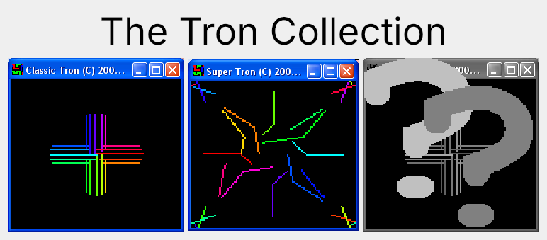

# TronCollection

C++ Tron Collection games



The Tron Collection: Classic Tron and Super Tron, simple multiplayer
Tron games for 2 to 20 players on one keyboard.

- Classic Tron: players move up, down, left or right
- Super Tron: players turn in steps of `360/n` degrees,
  where `n` is set by the 'Angles' slider

This is a Qt port of the C++ Builder (VCL) original
at [TronCollectionVcl](https://github.com/richelbilderbeek/TronCollectionVcl).

## How to play

 1. Click Classic Tron or Super Tron
 2. Choose the number of players (`+`/`-`), speed, world size,
    world shape (`S`: flat or donut-shaped) and whether bumping into your own trail hurts (`H`)
 3. Click `Calibrate`: each player presses a key to turn left, a key to turn right,
    then picks a color with `F1`-`F10`, `1`-`9`, `0` or a mouse click
 4. Click `Start`
 5. Bumping into another player's trail gives the owner of that trail a point,
    gives you a loss and wipes that trail. Bumping into your own trail (if harmful)
    or the edge of a flat world gives you a loss and wipes your trail
 6. Close the window (or press `Escape`) to see the losses and wins per player

## Build

Requires Qt 5.15 or Qt 6 and a C++17 compiler.

```
qmake TronCollection.pro
make
./TronCollection
```

Tests of the game rules:

```
cd tests
qmake TronCollectionTest.pro
make
./TronCollectionTest
```
